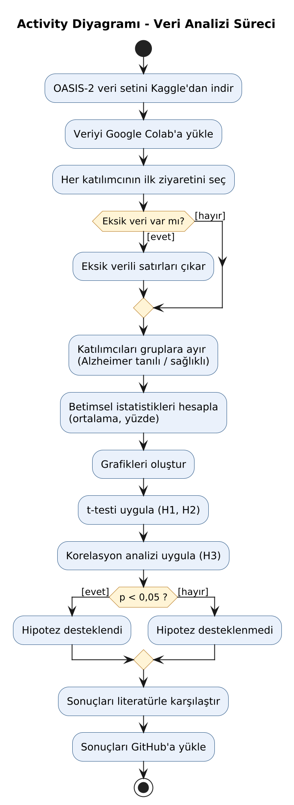

# Alzheimer Hastalığında Demografik ve Bilişsel Faktörlerin İkincil Veri Analizi

Hüsna Akman - 361526087
Araştırma Yöntem ve Teknikleri dersi proje çalışması

## Problem ve Amaç

Alzheimer, yaşlılarda en sık görülen nörolojik hastalıklardan biridir ve yaşlı nüfus arttıkça daha fazla insanı etkilemektedir. Yapılan çalışmalar yaş ve eğitim düzeyi gibi bazı faktörlerin Alzheimer ile ilişkili olduğunu göstermektedir. Bu projede açık erişimli bir veri seti kullanarak Alzheimer tanısı olan ve olmayan kişileri yaş, cinsiyet, eğitim, sosyoekonomik durum ve bilişsel test puanı açısından karşılaştırmayı amaçlıyorum.

Araştırma sorusu: Alzheimer tanısı olan ve olmayan bireyler yaş, cinsiyet, eğitim, sosyoekonomik durum ve MMSE puanı bakımından farklılık gösteriyor mu?

## Literatür

| Kaynak | Veri | Yöntem | Bulgu |
|---|---|---|---|
| Livingston vd. (2024) | Derleme | Lancet Komisyonu raporu | Demansla ilişkili 14 değiştirilebilir risk faktörü var, düşük eğitim bunlardan biri |
| Stern (2012) | Derleme | Bilişsel rezerv kuramı | Eğitim, Alzheimer'a bağlı beyin değişikliklerine rağmen bilişsel işlevlerin korunmasına yardımcı oluyor |
| Battineni vd. (2019) | OASIS-2 | Makine öğrenmesi (SVM) | Aynı veriyle demans tahmininde %68,75 doğruluk elde edilmiş |

Battineni ve arkadaşları aynı veriyi tahmin için kullanmış. Ben ise faktörlere tek tek bakarak hangisinin Alzheimer ile daha çok ilişkili olduğunu incelemek istiyorum.

Kaynaklar:
- Battineni, G., Chintalapudi, N., & Amenta, F. (2019). Machine learning in medicine: Performance calculation of dementia prediction by support vector machines (SVM). Informatics in Medicine Unlocked, 16, 100200. https://doi.org/10.1016/j.imu.2019.100200
- Livingston, G., Huntley, J., Liu, K. Y., vd. (2024). Dementia prevention, intervention, and care: 2024 report of the Lancet standing Commission. The Lancet, 404(10452), 572-628. https://doi.org/10.1016/S0140-6736(24)01296-0
- Marcus, D. S., Fotenos, A. F., Csernansky, J. G., Morris, J. C., & Buckner, R. L. (2010). Open Access Series of Imaging Studies (OASIS): Longitudinal MRI data in nondemented and demented older adults. Journal of Cognitive Neuroscience, 22(12), 2677-2684. https://doi.org/10.1162/jocn.2009.21407
- Stern, Y. (2012). Cognitive reserve in ageing and Alzheimer's disease. The Lancet Neurology, 11(11), 1006-1012. https://doi.org/10.1016/S1474-4422(12)70191-6

## Veri Seti

OASIS-2 veri setini kullanacağım. Washington Üniversitesi tarafından hazırlanmış ve ücretsiz olarak paylaşılmış bir veri seti. 60-96 yaş arası 150 kişinin bilgilerini içeriyor. Veri setinde hasta grubu "Demented" olarak adlandırılmıştır ve bu gruptaki bireyler çok hafif veya hafif düzeyde Alzheimer tanısı almıştır.

- Kaggle: https://www.kaggle.com/datasets/jboysen/mri-and-alzheimers
- Asıl kaynak: https://sites.wustl.edu/oasisbrains/home/oasis-2
- Değişkenler: grup (hasta / sağlıklı / sonradan hastalık gelişen), yaş, cinsiyet, eğitim yılı, sosyoekonomik durum, MMSE, CDR
- Kullanım koşulu: Ücretsiz, kullanırken OASIS'e ve Marcus vd. (2010) çalışmasına atıf yapılması gerekiyor.

Araştırma sorumdaki değişkenlerin hepsi bu veri setinde olduğu ve anket yapmadan hazır veriyle çalışabildiğim için bu veri setini seçtim. Örneklemin küçük olması ve yaşam tarzı bilgilerinin (sigara, tansiyon vb.) olmaması sınırlılık olarak düşünülebilir.

## Yöntem ve Hipotezler

Analizleri Google Colab'da Python ile yapmayı planlıyorum. İlk olarak betimsel istatistikler, t-testi ve korelasyon analizi kullanacağım. İki grubu karşılaştıracağım için bu testlerin uygun olduğunu düşünüyorum. Çalışma ilerledikçe yöntem değişebilir.

Hipotezler:
- H1: Alzheimer tanılı bireylerin eğitim yılı ortalaması daha düşüktür. (t-testi)
- H2: Alzheimer tanılı bireylerin yaş ortalaması daha yüksek, MMSE puanı daha düşüktür. (t-testi)
- H3: Eğitim yılı ile MMSE puanı arasında pozitif bir ilişki vardır. (korelasyon)

## UML Diyagramları

Diyagramlar `docs/uml` klasöründe yer almaktadır.

### Use Case Diyagramı
Araştırmacı (öğrenci) veriyi indirir, temizler, analiz eder, grafik oluşturur, sonuçları raporlar ve GitHub'a yükler. Eğitmen proje ilerlemesini GitHub üzerinden takip eder. Hipotez testleri her zaman p değerinin yorumlanmasını içerir (include). Eksik verili satırların çıkarılması ise yalnızca eksik veri varsa yapılır (extend).

### Activity Diyagramı
Verinin indirilmesinden sonuçların GitHub'a yüklenmesine kadar olan analiz sürecini gösterir. Eksik veri kontrolü ve p < 0,05 olmak üzere iki karar noktası vardır.

### Class Diyagramı
Projede kullanılan veriyi ve bu veriden üretilen sonuçları gösterir. Bir veri setinde birden fazla katılımcı, her katılımcının da birden fazla ziyareti bulunur. Hipotez testleri ve grafikler veri seti kullanılarak oluşturulur ve raporda bir araya getirilir.

## Sonraki Adımlar

- Veri setini indirip depoya eklemek
- Google Colab'da ilk tabloları ve grafikleri oluşturmak
- Hipotezleri test etmek
- Makaleleri daha detaylı okumak
