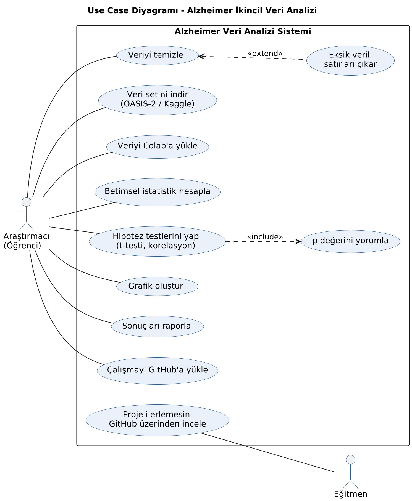
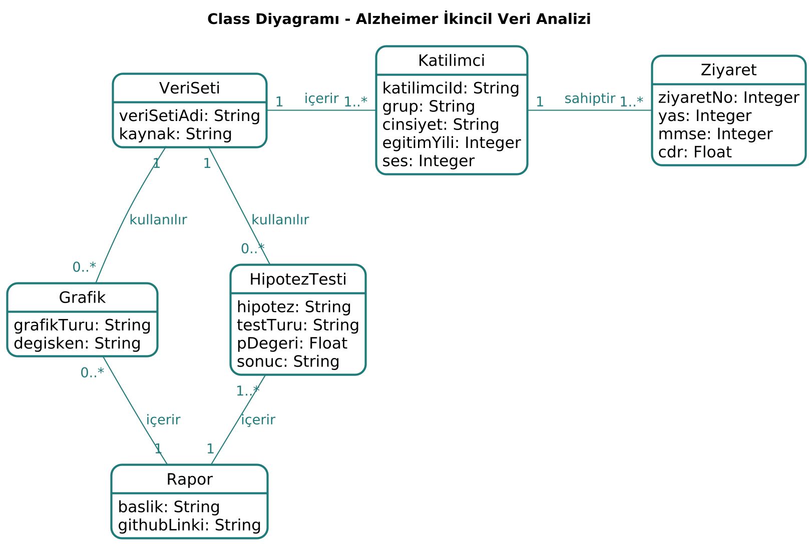

## UML Diyagramları

Diyagramlar `docs/uml` klasöründe yer almaktadır.

### Use Case Diyagramı
Araştırmacı (öğrenci) veriyi indirir, temizler, analiz eder, grafik oluşturur, sonuçları raporlar ve GitHub'a yükler. Eğitmen proje ilerlemesini GitHub üzerinden takip eder. Hipotez testleri her zaman p değerinin yorumlanmasını içerir (include). Eksik verili satırların çıkarılması ise yalnızca eksik veri varsa yapılır (extend).

### Activity Diyagramı
Verinin indirilmesinden sonuçların GitHub'a yüklenmesine kadar olan analiz sürecini gösterir. Eksik veri kontrolü ve p < 0,05 olmak üzere iki karar noktası vardır.

### Class Diyagramı
Projede kullanılan veriyi ve bu veriden üretilen sonuçları gösterir. Bir veri setinde birden fazla katılımcı, her katılımcının da birden fazla ziyareti bulunur. Hipotez testleri ve grafikler veri seti kullanılarak oluşturulur ve raporda bir araya getirilir.

